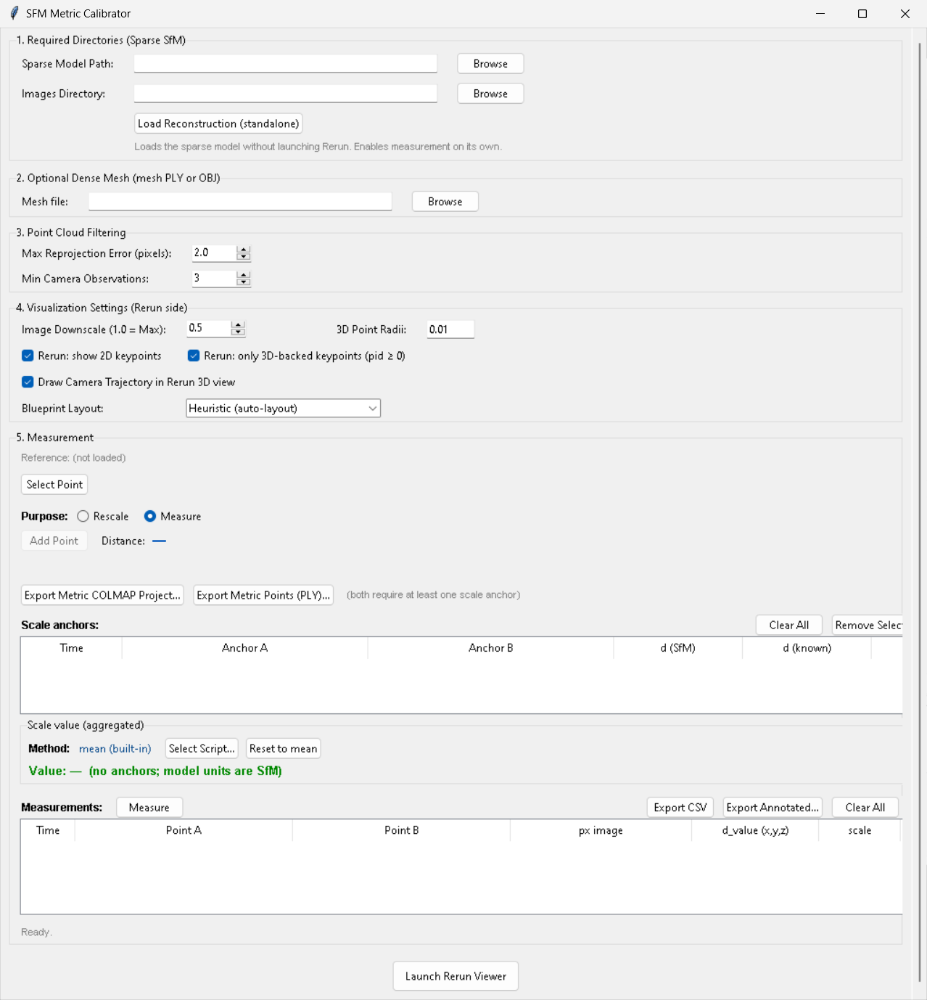
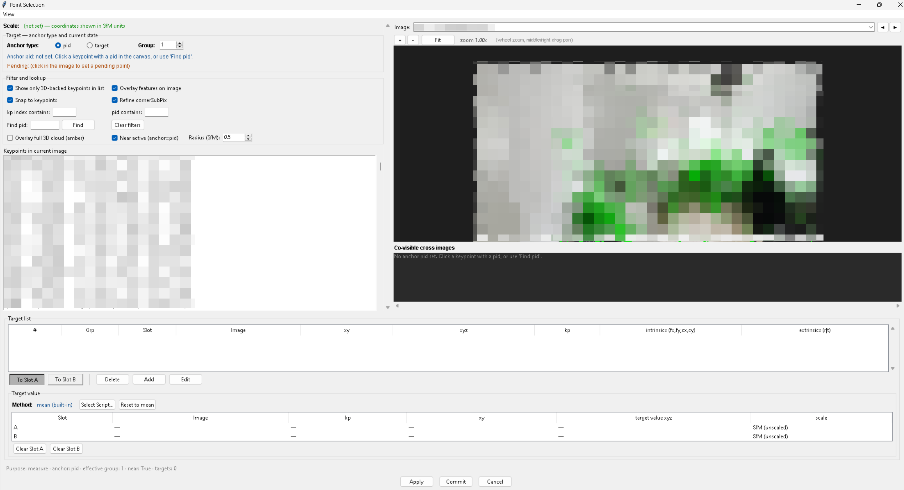

# SFM Metric Calibrator

A Windows desktop tool for estimating metric scale in COLMAP sparse reconstructions using known distances and image-point observations. It prepares metrically scaled camera poses and sparse geometry for downstream 3D Gaussian Splatting workflows.

## Motivation

Structure-from-Motion reconstructions have arbitrary scale, which downstream training preserves. Selecting reference points in trained Gaussian scenes is unreliable due to lower rendered texture resolution. This tool uses the original images for point selection and rescales the sparse reconstruction before training.

## Features

- Select existing COLMAP 2D–3D correspondences or manually mark image points.
- Triangulate observations of the same physical point across multiple views.
- Estimate metric scale from known distances and combine multiple scale anchors.
- Inspect the reconstruction in Rerun.
- Export a rescaled COLMAP sparse model, a scaled PLY point cloud, and calibration metadata.

## Installation and Launch

Requirements: Windows 64-bit, Python 3.11+ (64-bit) with the Python Launcher (`py.exe`), and internet access for initial dependency installation.

Each release contains:

~~~text
SFM-Metric-Calibrator-vx.x.x/
├── launch.bat
├── sfm_metric_calibrator-x.x.x-py3-none-any.whl
└── README.md
~~~

Keep the launcher and matching wheel in the same directory, then double-click `launch.bat`. It creates a local `.venv` if needed, installs the application and dependencies, and starts the application. Subsequent launches reuse the environment; the system Python environment is not modified.

## Quick Start

1. Set **Sparse Model Path** and **Images Directory**.
2. Click **Load Reconstruction (standalone)**.
3. Click **Select Point**, select an image keypoint, assign it to **Slot A** or **Slot B**, and click **Add**.
4. If no suitable existing COLMAP 3D point is available, triangulate the physical point from observations across multiple images. Repeat for the second point.
5. Click **Apply** to update the main window while keeping the selection popup open, or **Commit** to close it.
6. Enter the known distance and click **Add Scale Anchor**. Repeat for additional anchors if needed.
7. Optionally, use **Add Point** and **Measure** to record and recompute measurement rows.
8. Export using **Export Metric COLMAP Project…** or **Export Metric Points (PLY)…**.

## Input and Output

Input:

~~~text
project/
├── sparse/
│   └── 0/       # COLMAP reconstruction (binary or text)
└── images/      # Source images referenced by COLMAP
~~~

The metric project export contains:

~~~text
metric_project_<YYYYMMDD_HHMMSS>/
├── sparse/
│   └── 0/       # Rescaled cameras, images, and points3D
├── images/      # Optional
├── database.db  # Optional
└── rescale_info.txt
~~~

The PLY export produces a single ASCII point cloud. The sparse-model export is reloaded and its camera, image, and 3D point counts are verified; handled export failures remove the partial project folder.

## Scaling and Limitations

The default scale is the arithmetic mean of the anchor ratios `d_metric / d_SfM`. Scaling multiplies `points3D.xyz` and camera translations by this factor while preserving rotations, intrinsics, and 2D observations. The reconstruction's original orientation and origin are retained; the output is not georeferenced.

Calibration accuracy depends on point selection, triangulation geometry, camera calibration, and known-distance accuracy. Validate exported data before production use.

## Runtime Dependencies

The application uses PyCOLMAP, Rerun SDK, NumPy, OpenCV, Pillow, and Tkinter. Dependencies are installed into the local virtual environment from the wheel's package metadata; `requirements.txt` documents them. Rerun SDK is required at startup and is used by **Launch Rerun Viewer**, not by the manual calibration workflow.

Automatic marker-based calibration, such as ArUco, may be considered in a future extension.
